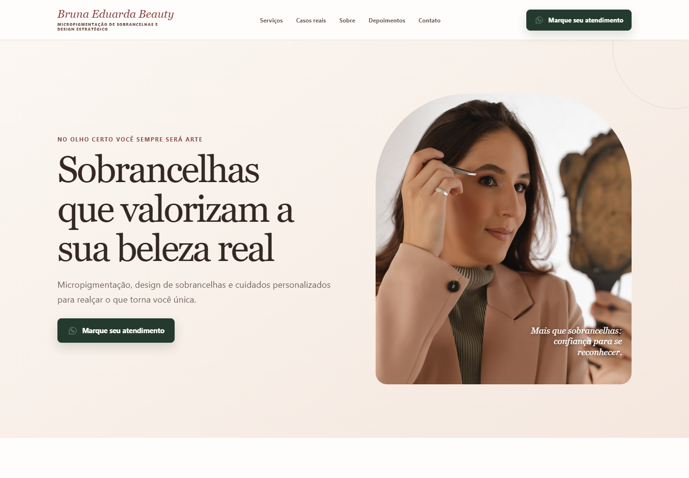

# Bruna Eduarda Beauty

Landing page estática para apresentar os serviços de design e micropigmentação de sobrancelhas da Bruna Eduarda Beauty, em Coromandel, MG. O principal caminho de conversão é o agendamento pelo WhatsApp.

## Abrir o projeto

- **Ver no navegador local:** [abra `index.html`](index.html) ou abra esse arquivo diretamente no navegador.
- **Repositório:** [github.com/nunesd66/cartao-visitas-bruna](https://github.com/nunesd66/cartao-visitas-bruna)
- **Site publicado:** [nunesd66.github.io/cartao-visitas-bruna](https://nunesd66.github.io/cartao-visitas-bruna/). A branch `master` é publicada pelo GitHub Pages; esta branch de preparação não altera o site público.

## Prévia

Capturas da versão atual, feitas localmente em 17/11/2026:

| Desktop · 1440 px | Celular · 390 px |
| --- | --- |
|  |  |

[Ver captura completa da página em desktop](docs/screenshots/desktop.png)

## O que a página apresenta

- Hero com chamada para agendamento.
- Serviços de micropigmentação, design de sobrancelhas, tintura e henna.
- Galerias de resultados na seção Serviços, com alternância automática a cada 3 segundos, transição de 0,5 segundo e um controle compartilhado de pausa/retomada; respeitam a preferência por movimento reduzido do dispositivo.
- Casos reais, apresentação da profissional e avaliações de clientes.
- Perguntas frequentes, chamada final, localização e canais de contato.
- Navegação por teclado, menu móvel, cabeçalho que acompanha a direção da rolagem e carrossel de depoimentos com avanço automático, pausa/retomada e botões anterior/próximo; a rotação respeita a preferência por movimento reduzido.

### Links do rodapé

Os sete links do rodapé permanecem em uma linha quando há espaço suficiente. Em telas médias, eles se distribuem em duas linhas equilibradas; em telas menores, usam três linhas centralizadas (3 + 2 + 2). Os ícones compartilham o mesmo tamanho e os links mantêm uma área de toque confortável.

### Navegação e cabeçalho

Os links de navegação levam diretamente aos títulos das seções, evitando que o espaço interno da seção deixe o título afastado do topo. O cabeçalho aparece ao carregar a página ou ao rolar para cima e se recolhe ao rolar para baixo, próximo à seção Serviços. O botão de alfinete mantém o cabeçalho visível enquanto estiver ativado; ao desativá-lo, o comportamento de rolagem é retomado. A fixação vale até recarregar a página.

## Tecnologias e estrutura

Projeto sem framework ou dependências de runtime. O HTML é semântico, os estilos são escritos em SCSS e servidos pelo CSS compilado; o JavaScript vanilla é usado para interações progressivas.

```text
.
├── index.html                 # Conteúdo e estrutura da página
├── css/
│   ├── style.scss              # Fonte dos estilos e variáveis de tema
│   └── style.css               # CSS compilado, carregado pelo HTML
├── js/
│   └── main.js                 # Menu, FAQ, parallax e carrossel
├── images/                     # Fotos, resultados e avaliações
└── docs/
    └── screenshots/            # Capturas usadas nesta documentação
```

### Executar e desenvolver

Não é necessário instalar pacotes para abrir a página. Para uma prévia local, abra `index.html`. Se preferir servir por HTTP, na raiz do projeto execute:

```bash
python -m http.server 8080
```

Depois acesse <http://localhost:8080>.

Para compilar os estilos, é necessário ter Node.js `>=20.19.0` e npm. O requisito decorre da versão de `sass` (`1.108.2`) travada no `package-lock.json`; Sass é dependência apenas de desenvolvimento. Instale as versões travadas e compile o SCSS assim:

```bash
npm ci
npm run build:css
```

Ao alterar os estilos, edite `css/style.scss` e gere novamente `css/style.css`. O `index.html` carrega o CSS compilado; mudanças apenas no SCSS não aparecem no navegador até a compilação. A página publicada é estática e não precisa de npm ou Node em runtime.

### SEO e publicação

O HTML define canonical, Open Graph e JSON-LD com informações já exibidas na página. `robots.txt` e `sitemap.xml` devem estar na raiz publicada para responder em `/robots.txt` e `/sitemap.xml`. Não há favicon de marca aprovado; não crie um ícone provisório. Até haver uma marca gráfica aprovada, `<link rel="icon" href="data:,">` evita a tentativa automática do navegador a `/favicon.ico`. Quando um favicon aprovado estiver disponível, use um caminho relativo ao projeto (base `/cartao-visitas-bruna/`) e confirme HTTP 200.

Em telas abaixo de 60 rem, o botão de fixar cabeçalho fica oculto para manter a marca e o menu dentro da largura disponível. Ele aparece apenas em desktop com ponteiro preciso; a navegação móvel segue sem esse controle.

Antes de publicar, revise os arquivos do diff, execute `npm run build:css`, confira os links/URLs e acompanhe o workflow **pages build and deployment** em GitHub Actions. Após o deploy, valide HTTP 200 para a página, CSS, JS, imagens, robots e sitemap; repita Lighthouse mobile/desktop. O GA4 permanece desativado até haver um Measurement ID real e uma decisão de consentimento conectada.

## Mensuração com Google Analytics 4

### Arquitetura e estado padrão

A implementação usa `gtag.js` sem bibliotecas adicionais. O `index.html` contém `meta[name="ga4-measurement-id"]` com valor vazio; este não é um ID fictício. `js/analytics.js`, carregado antes de `js/main.js`, só solicita o Google tag quando encontra um ID válido `G-...` e recebe consentimento explícito por `window.BrunaAnalytics.setConsent(true)`. Sem qualquer uma dessas condições, não cria `dataLayer`, não carrega script remoto, não define cookies e descarta eventos.

O fluxo usa o modo básico de Consent Mode: o tag não carrega antes da escolha de consentimento. Após a concessão, o código define todos os estados como `denied`, atualiza apenas `analytics_storage` para `granted` e mantém os estados de publicidade negados. Google Signals e personalização de anúncios ficam desativados. Ao negar ou revogar, o código bloqueia os eventos próprios e, se o tag já tiver sido iniciado, atualiza os estados para `denied`.

Não existe banner, texto de consentimento nem armazenamento da escolha neste projeto. Uma CMP ou solução aprovada deve chamar `window.BrunaAnalytics.setConsent(true)` após a pessoa autorizar Analytics e `window.BrunaAnalytics.setConsent(false)` ao negar ou revogar. Ela também precisa restaurar a escolha previamente registrada em cada carregamento. A redação e a solução de consentimento continuam dependências externas; não ativar o ID antes disso.

O `page_view` é enviado uma vez após a concessão, com `send_page_view: false` na configuração para evitar duplicidade. `page_location` é limitado à origem e ao caminho; `page_referrer`, quando disponível, é limitado à origem. Query string e fragmento não são enviados por esses parâmetros. Isso preserva indicação de origem por domínio, mas não atribuição de campanhas UTM. Não incluir dados pessoais em URLs de entrada.

### Eventos e parâmetros

O listener delegado existente em `js/main.js` continua sendo o único listener de cliques analíticos. `js/analytics.js` valida uma lista fechada de eventos e parâmetros e normaliza os atributos `data-analytics-*` existentes:

| Evento enviado ao GA4 | Origem no HTML | Parâmetros permitidos | O que mede |
| --- | --- | --- | --- |
| `page_view` | Configuração GA4 | página sem query/fragmento; origem do referrer | Página carregada após consentimento; métricas de usuários, sessões e aquisição são calculadas pelo GA4. |
| `contact_intent` | `whatsapp_booking_click` e `contact_channel_click` com `channel=whatsapp` | `channel=whatsapp`, `cta_location`, `service_name` opcional | Clique para iniciar contato pelo WhatsApp. É intenção, não agendamento ou lead concluído. Cliques em CTAs de serviço permitem comparar o interesse por slug de serviço. |
| `contact_channel_click` | `contact_channel_click`, `testimonial_source_click` e `review_request_click` | `channel` (`phone`, `google_maps`, `instagram` ou `google`), `cta_location` | Clique em canal ou fonte externa. Maps e Instagram são distinguidos por `channel`; acessos ao Google para avaliações usam `google`. |
| `faq_open` | `faq_open` | `faq_id` (`faq_01` a `faq_06`) | Abertura de pergunta frequente, sem enviar o texto da pergunta. |

`generate_lead` não é enviado: um clique no WhatsApp não comprova que uma conversa, lead ou agendamento foi concluído. O código não envia URL de destino, texto do link, telefone, conteúdo da avaliação, pergunta, mensagem do WhatsApp, nome de cliente ou texto digitado. Os parâmetros `channel`, `cta_location`, `service_name` e `faq_id` são filtrados por valores permitidos. Para consultar parâmetros personalizados nos relatórios padrão, registre-os como dimensões personalizadas na propriedade GA4.

### Configuração e ativação

1. No fluxo Web da propriedade GA4, copie o Measurement ID real iniciado por `G-`.
2. Depois da decisão de consentimento e da integração com a solução aprovada, preencha somente o `content` de `meta[name="ga4-measurement-id"]` em `index.html`.
3. Conecte a CMP/solução aprovada à API `window.BrunaAnalytics.setConsent`. Não persista a escolha neste código; a solução de consentimento é responsável por guardar e restaurar a escolha.
4. Na propriedade GA4, revise a Mensuração otimizada: desative cliques de saída para evitar um segundo evento automático `click` e coleta de `link_url` (os canais relevantes já têm eventos próprios); desative mudanças de página baseadas no histórico do navegador para não tratar âncoras/hash da landing page como novas páginas. Revise também quaisquer outras medições automáticas antes de ativar.
5. Após publicar com autorização, valide a tag no Tag Assistant e no DebugView. Só afirmar recebimento quando houver evidência real nesses produtos.

Referências oficiais: [instalação do Google tag](https://support.google.com/analytics/answer/14183469?hl=pt-BR), [eventos recomendados GA4](https://developers.google.com/analytics/devguides/collection/ga4/reference/events), [Consent Mode para sites](https://developers.google.com/tag-platform/security/guides/consent), [eventos de Mensuração otimizada](https://support.google.com/analytics/answer/9216061?hl=pt-BR), [parâmetros e dimensões personalizadas](https://developers.google.com/analytics/devguides/collection/ga4/event-parameters).

### Testes locais

```bash
node --check js/analytics.js
node --check js/main.js
node --test scripts/analytics.test.mjs
```

Os testes usam um ID de fixture somente no contexto Node isolado; o HTML público permanece sem Measurement ID. Eles verificam ausência de script/fila sem configuração, consentimento obrigatório, uma única inicialização, normalização de eventos, filtragem de parâmetros e revogação. O envio real deve ser confirmado no Tag Assistant/DebugView após configuração e autorização; os testes locais não simulam dados recebidos pelo GA4.

Para reverter um deploy defeituoso, crie um novo commit com `git revert <sha-do-commit-de-publicação>` e confirme o novo workflow de Pages. A tag `backup-2026-11-16` é uma referência histórica anterior a alterações aprovadas depois de 16/11; não mova `master` diretamente para ela nem use force-push.

## Evolução do repositório

O gráfico abaixo resume os **19 commits** existentes no histórico local até 17/11/2026. Ele mostra a atividade por data, não uma medida de qualidade ou de funcionalidades.


| Data | Commits | Marco |
| --- | ---: | --- |
| 08/09/2026 | 1 | Primeiro esboço da landing page |
| 16/11/2026 | 17 | Conteúdo, responsividade, casos reais, acessibilidade e refinamentos visuais |
| 17/11/2026 | 1 | Ícones na navegação do rodapé |

## Conteúdo a revisar antes de publicar

Confirme textos, telefone e links de agendamento, endereço e horário de atendimento. As informações de contato ficam no `index.html`; imagens e textos também podem ser substituídos diretamente no HTML. O site está publicado no [GitHub Pages](https://nunesd66.github.io/cartao-visitas-bruna/). Alterações entram no site público após integração na branch `master` e conclusão bem-sucedida do workflow de publicação.

## Preservação obrigatória do conteúdo textual

Nenhum texto existente no site pode ser alterado sem autorização explícita do responsável pelo projeto. Isso inclui títulos, subtítulos, parágrafos, CTAs, menus, serviços, FAQ, avaliações, dados comerciais e de contato, mensagens de WhatsApp, textos alternativos (alt), rótulos acessíveis (ARIA) e metadados textuais de SEO. Alterações estruturais, de estilo, acessibilidade, desempenho e interação são permitidas desde que preservem integralmente esses textos. Se uma melhoria exigir mudança textual, apresente a proposta e aguarde autorização específica. Antes de cada commit, compare o conteúdo textual antes e depois e rejeite qualquer diferença não autorizada.
