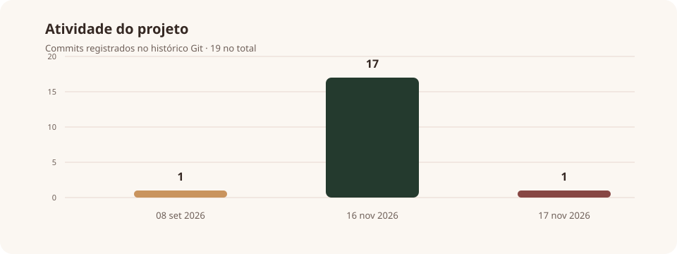

# Bruna Eduarda Beauty

Landing page estática para apresentar os serviços de design e micropigmentação de sobrancelhas da Bruna Eduarda Beauty, em Coromandel, MG. O principal caminho de conversão é o agendamento pelo WhatsApp.

## Abrir o projeto

- **Ver no navegador local:** [abra `index.html`](index.html) ou abra esse arquivo diretamente no navegador.
- **Repositório:** [github.com/nunesd66/cartao-visitas-bruna](https://github.com/nunesd66/cartao-visitas-bruna)
- **Site publicado:** [nunesd66.github.io/cartao-visitas-bruna](https://nunesd66.github.io/cartao-visitas-bruna/). A branch `master` é publicada pelo GitHub Pages; esta branch de preparação não altera o site público.

## Prévia

Capturas da versão atual, feitas localmente em 17/11/2026:

| Desktop · 1440 px | Celular · 390 px |
| --- | --- |
|  |  |

[Ver captura completa da página em desktop](docs/screenshots/desktop.png)

## O que a página apresenta

- Hero com chamada para agendamento.
- Serviços de micropigmentação, design de sobrancelhas, tintura e henna.
- Galerias de resultados na seção Serviços, com alternância automática a cada 3 segundos, transição de 0,5 segundo e respeito à preferência por movimento reduzido do dispositivo.
- Casos reais, apresentação da profissional e avaliações de clientes.
- Perguntas frequentes, chamada final, localização e canais de contato.
- Navegação por teclado, menu móvel, cabeçalho que acompanha a direção da rolagem e carrossel de depoimentos com avanço automático, pausa/retomada e botões anterior/próximo; a rotação respeita a preferência por movimento reduzido.

### Links do rodapé

Os sete links do rodapé permanecem em uma linha quando há espaço suficiente. Em telas médias, eles se distribuem em duas linhas equilibradas; em telas menores, usam três linhas centralizadas (3 + 2 + 2). Os ícones compartilham o mesmo tamanho e os links mantêm uma área de toque confortável.

### Navegação e cabeçalho

Os links de navegação levam diretamente aos títulos das seções, evitando que o espaço interno da seção deixe o título afastado do topo. O cabeçalho aparece ao carregar a página ou ao rolar para cima e se recolhe ao rolar para baixo, próximo à seção Serviços. O botão de alfinete mantém o cabeçalho visível enquanto estiver ativado; ao desativá-lo, o comportamento de rolagem é retomado. A fixação vale até recarregar a página.

## Tecnologias e estrutura

Projeto sem framework ou dependências de runtime. O HTML é semântico, os estilos são escritos em SCSS e servidos pelo CSS compilado; o JavaScript vanilla é usado para interações progressivas.

```text
.
├── index.html                 # Conteúdo e estrutura da página
├── css/
│   ├── style.scss              # Fonte dos estilos e variáveis de tema
│   └── style.css               # CSS compilado, carregado pelo HTML
├── js/
│   └── main.js                 # Menu, FAQ, parallax e carrossel
├── images/                     # Fotos, resultados e avaliações
└── docs/
    └── screenshots/            # Capturas usadas nesta documentação
```

### Executar e desenvolver

Não é necessário instalar pacotes para abrir a página. Para uma prévia local, abra `index.html`. Se preferir servir por HTTP, na raiz do projeto execute:

```bash
python -m http.server 8080
```

Depois acesse <http://localhost:8080>.

Para compilar os estilos, é necessário ter Node.js `>=20.19.0` e npm. O requisito decorre da versão de `sass` (`1.108.2`) travada no `package-lock.json`; Sass é dependência apenas de desenvolvimento. Instale as versões travadas e compile o SCSS assim:

```bash
npm ci
npm run build:css
```

Ao alterar os estilos, edite `css/style.scss` e gere novamente `css/style.css`. O `index.html` carrega o CSS compilado; mudanças apenas no SCSS não aparecem no navegador até a compilação. A página publicada é estática e não precisa de npm ou Node em runtime.

### SEO e publicação

O HTML define canonical, Open Graph e JSON-LD com informações já exibidas na página. `robots.txt` e `sitemap.xml` devem estar na raiz publicada para responder em `/robots.txt` e `/sitemap.xml`. Não há favicon de marca aprovado; não crie um ícone provisório. Até haver uma marca gráfica aprovada, `<link rel="icon" href="data:,">` evita a tentativa automática do navegador a `/favicon.ico`. Quando um favicon aprovado estiver disponível, use um caminho relativo ao projeto (base `/cartao-visitas-bruna/`) e confirme HTTP 200.

Em telas abaixo de 60 rem, o botão de fixar cabeçalho fica oculto para manter a marca e o menu dentro da largura disponível. Ele aparece apenas em desktop com ponteiro preciso; a navegação móvel segue sem esse controle.

Antes de publicar, revise os arquivos do diff, execute `npm run build:css`, confira os links/URLs e acompanhe o workflow **pages build and deployment** em GitHub Actions. Após o deploy, valide HTTP 200 para a página, CSS, JS, imagens, robots e sitemap; repita Lighthouse mobile/desktop. O Measurement ID real está configurado, mas o GA4 permanece desativado até haver uma decisão de consentimento aprovada e conectada.

## Mensuração com Google Analytics 4

### Arquitetura e estado padrão

A implementação usa `gtag.js` sem bibliotecas adicionais. O `index.html` contém o Measurement ID real confirmado para o fluxo Web: `G-YVS4N0BZ9S` (Stream ID `16362293759`). `js/analytics.js`, carregado antes de `js/privacy.js` e `js/main.js`, só solicita o Google tag depois de consentimento afirmativo. `js/privacy.js` chama `setConsent(true)` apenas quando restaura uma escolha aceita ou quando a pessoa aciona Aceitar. Em primeira visita sem escolha, recusa ou revogação, não cria `dataLayer`, não carrega script remoto nem envia eventos.

O fluxo usa o modo básico de Consent Mode: o tag não carrega antes da escolha afirmativa. Após aceitar, o código define todos os estados como `denied`, atualiza apenas `analytics_storage` para `granted` e mantém os estados de publicidade negados. Google Signals e personalização de anúncios ficam desativados. Recusa ou revogação bloqueiam eventos próprios, atualizam o Consent Mode para `denied` e ativam `ga-disable-<ID>` para interromper novas transmissões.

### Componente de privacidade

`js/privacy.js` apresenta o painel na primeira visita sem decisão, oferece Aceitar e Recusar e mantém o controle Privacidade disponível para alterar a escolha. A escolha é persistida no `localStorage` sob `bruna-analytics-consent-v1`; apenas os valores `accepted` ou `rejected` são armazenados. Não há opção pré-selecionada e a ausência de escolha mantém a coleta desligada. Se o navegador impedir armazenamento local, a decisão explícita vale somente até o fim daquela página e o pedido reaparece na próxima visita.

Ao recusar ou revogar depois de aceitar, o código desativa o Google tag, bloqueia novos eventos e tenta remover cookies GA acessíveis (`_ga`, `_ga_*` e famílias relacionadas) no domínio/caminho atual. Isso não apaga dados já transmitidos aos servidores do Google; pedidos de eliminação/retention e dados históricos exigem controles da propriedade GA4. Acessar Privacidade reabre as opções sem presumir que a pessoa manteve a decisão anterior.

O componente é uma interface técnica mínima, não uma política de privacidade nem garantia de conformidade legal. Antes de ativar a coleta, a responsável deve validar a base legal, transparência e documentação aplicáveis, incluindo quem controla os dados, finalidades, dados/cookies tratados, destinatários (incluindo Google), retenção, transferências aplicáveis, canal de contato e direitos/revogação. A ANPD recomenda informação clara e procedimento gratuito/facilitado para revogar o consentimento; avaliar com orientação jurídica ou de privacidade a necessidade e o conteúdo de um aviso/política de privacidade e cookies. Consulte o [Guia orientativo da ANPD sobre cookies](https://www.gov.br/anpd/pt-br/centrais-de-conteudo/materiais-educativos-e-publicacoes/guia_orientativo_cookies_e_protecao_de_dados_pessoais) e a página de [direitos dos titulares](https://www.gov.br/anpd/pt-br/assuntos/titular-de-dados/direito-dos-titulares).

O código configura `send_page_view: false` e envia um `page_view` manual após consentimento, evitando a pageview padrão do comando `config`. A Mensuração otimizada da propriedade também pode enviar pageviews em alterações do histórico do navegador, independentemente dessa opção; como o site navega por âncoras, desative a medição de mudanças por histórico na propriedade antes de ativar a coleta. `page_location` é limitado à origem e ao caminho; `page_referrer`, quando disponível, é limitado à origem. Query string e fragmento não são enviados por esses parâmetros. Isso preserva indicação de origem por domínio, mas não atribuição de campanhas UTM. Não incluir dados pessoais em URLs de entrada.

### Eventos e parâmetros

O listener delegado existente em `js/main.js` continua sendo o único listener de cliques analíticos. `js/analytics.js` valida uma lista fechada de eventos e parâmetros e normaliza os atributos `data-analytics-*` existentes:

| Evento enviado ao GA4 | Origem no HTML | Parâmetros permitidos | O que mede |
| --- | --- | --- | --- |
| `page_view` | Configuração GA4 | página sem query/fragmento; origem do referrer | Página carregada após consentimento; métricas de usuários, sessões e aquisição são calculadas pelo GA4. |
| `contact_intent` | `whatsapp_booking_click` e `contact_channel_click` com `channel=whatsapp` | `channel=whatsapp`, `cta_location`, `service_name` opcional | Clique para iniciar contato pelo WhatsApp. É intenção, não agendamento ou lead concluído. Cliques em CTAs de serviço permitem comparar o interesse por slug de serviço. |
| `contact_channel_click` | `contact_channel_click`, `testimonial_source_click` e `review_request_click` | `channel` (`phone`, `google_maps`, `instagram` ou `google`), `cta_location` | Clique em canal ou fonte externa. Maps e Instagram são distinguidos por `channel`; acessos ao Google para avaliações usam `google`. |
| `faq_open` | `faq_open` | `faq_id` (`faq_01` a `faq_06`) | Abertura de pergunta frequente, sem enviar o texto da pergunta. |

`generate_lead` não é enviado: um clique no WhatsApp não comprova que uma conversa, lead ou agendamento foi concluído. O código não envia URL de destino, texto do link, telefone, conteúdo da avaliação, pergunta, mensagem do WhatsApp, nome de cliente ou texto digitado. Os parâmetros `channel`, `cta_location`, `service_name` e `faq_id` são filtrados por valores permitidos. Para consultar parâmetros personalizados nos relatórios padrão, registre-os como dimensões personalizadas na propriedade GA4.

### Configuração e ativação

1. O Measurement ID real já está configurado: `G-YVS4N0BZ9S`; não substituir por outro sem confirmação da propriedade.
2. A interface de primeira camada está implementada. Aprove o comportamento e providencie a revisão do aviso/política de privacidade e cookies; confirme que as informações de controlador, finalidade, base legal, compartilhamento, retenção e direitos são suficientes para o caso concreto.
3. A Mensuração otimizada está ativada na propriedade. Antes da coleta, desligue **cliques de saída** ou aprove explicitamente a coleta sobreposta: os cliques personalizados `contact_intent`/`contact_channel_click` coexistiriam com o evento automático `click`, que inclui `link_url` (potencialmente URL de WhatsApp com telefone e mensagem pré-preenchida). Recomendamos desligar cliques de saída para reduzir duplicação e exposição de dados.
4. Desative também mudanças de pageview baseadas em histórico do navegador, evitando pageviews extras em navegação interna; mantenha o `page_view` manual único. Revise as demais opções antes de ativar: `scroll` não duplica evento próprio; `form_start`/`form_submit` podem registrar interação com o formulário de dúvidas do WhatsApp (sem evento personalizado equivalente); não foram encontrados links para downloads. Desative a pesquisa de site automática ou confirme que URLs nunca usarão `q`, `s`, `search`, `query` ou `keyword` com valores pessoais, pois esses parâmetros podem gerar evento e termo de pesquisa automáticos.
5. Após publicar com autorização, valide a tag no Tag Assistant e no DebugView. Só afirmar recebimento quando houver evidência real nesses produtos.

Referências oficiais: [instalação do Google tag](https://support.google.com/analytics/answer/14183469?hl=pt-BR), [eventos recomendados GA4](https://developers.google.com/analytics/devguides/collection/ga4/reference/events), [Consent Mode para sites](https://developers.google.com/tag-platform/security/guides/consent), [eventos de Mensuração otimizada](https://support.google.com/analytics/answer/9216061?hl=pt-BR), [pageviews e mudanças de histórico](https://developers.google.com/analytics/devguides/collection/ga4/views), [parâmetros e dimensões personalizadas](https://developers.google.com/analytics/devguides/collection/ga4/event-parameters).

### Testes locais

```bash
node --check js/analytics.js
node --check js/privacy.js
node --check js/main.js
node --test scripts/analytics.test.mjs scripts/privacy.test.mjs
```

Os testes usam IDs fixture somente no contexto Node isolado. A página contém o ID real, mas em primeira visita, recusa ou revogação não carrega a tag remota. Os testes verificam consentimento, persistência, restauração, revogação, remoção de cookies acessíveis, atributos/estrutura acessível e regras responsivas. O envio real deve ser confirmado no Tag Assistant/DebugView após revisão e decisão; os testes locais não simulam dados recebidos pelo GA4.

Para reverter um deploy defeituoso, crie um novo commit com `git revert <sha-do-commit-de-publicação>` e confirme o novo workflow de Pages. A tag `backup-2026-11-16` é uma referência histórica anterior a alterações aprovadas depois de 16/11; não mova `master` diretamente para ela nem use force-push.

## Evolução do repositório

O gráfico abaixo resume os **19 commits** existentes no histórico local até 17/11/2026. Ele mostra a atividade por data, não uma medida de qualidade ou de funcionalidades.



| Data | Commits | Marco |
| --- | ---: | --- |
| 08/09/2026 | 1 | Primeiro esboço da landing page |
| 16/11/2026 | 17 | Conteúdo, responsividade, casos reais, acessibilidade e refinamentos visuais |
| 17/11/2026 | 1 | Ícones na navegação do rodapé |

## Conteúdo a revisar antes de publicar

Confirme textos, telefone e links de agendamento, endereço e horário de atendimento. As informações de contato ficam no `index.html`; imagens e textos também podem ser substituídos diretamente no HTML. O site está publicado no [GitHub Pages](https://nunesd66.github.io/cartao-visitas-bruna/). Alterações entram no site público após integração na branch `master` e conclusão bem-sucedida do workflow de publicação.

## Preservação obrigatória do conteúdo textual

Nenhum texto existente no site pode ser alterado sem autorização explícita do responsável pelo projeto. Isso inclui títulos, subtítulos, parágrafos, CTAs, menus, serviços, FAQ, avaliações, dados comerciais e de contato, mensagens de WhatsApp, textos alternativos (alt), rótulos acessíveis (ARIA) e metadados textuais de SEO. Alterações estruturais, de estilo, acessibilidade, desempenho e interação são permitidas desde que preservem integralmente esses textos. Se uma melhoria exigir mudança textual, apresente a proposta e aguarde autorização específica. Antes de cada commit, compare o conteúdo textual antes e depois e rejeite qualquer diferença não autorizada.

## Auditoria UX/UI de 17/11/2026

Na avaliação inicial, o PR #7 foi verificado na branch `ux-mobile-ui-polish-2026-11-17`, commit `620057b7a490aa21041668cc0553a7997fe9f91f`, antes do merge. Depois, o PR foi integrado à `master` pelo commit `434a5ae`. Os resultados daquela auditoria referem-se à branch avaliada naquele momento, não à produção. O workflow de Pull Request checks (run #22) concluiu com sucesso.

A auditoria visual e as interações em navegador ficaram **não verificadas**: a automação do Firefox foi bloqueada pela política de URL do navegador nesta sessão antes de abrir a página. Não foram produzidas capturas de tela, medições Lighthouse ou observações de Network. Nenhum defeito P0–P3 foi confirmado; isso não comprova ausência de defeitos. O baseline informado para referência (mobile: Performance 98, LCP 1,54 s; desktop: Performance 100, LCP 0,50 s) não foi re-medido nesta auditoria. Consulte o relatório privado em `.local/relatorios/evolucao-comercial.md` antes de considerar a avaliação visual concluída.

## Validação analítica e Gate A — 17/11/2026

Na validação inicial, `master` estava no commit `da6426e8e706a47a64ce76b99320e6bb81b22e2f` e PR #7 ainda estava aberta; ela foi posteriormente integrada pelo commit `434a5ae`. O workflow `pages build and deployment` (run #44174925040) concluiu os jobs de build e deploy com sucesso para o commit da master então vigente.

Na URL pública, a página, CSS, JavaScript, as imagens referenciadas (incluindo as quatro fotografias de galeria), `robots.txt` e `sitemap.xml` responderam HTTP 200. Canonical, Open Graph, metatag de verificação do Search Console e JSON-LD `BeautySalon` foram encontrados; o JSON-LD foi parseado com sucesso e não foi encontrado `noindex`. Isso confirma indexabilidade técnica, não indexação efetiva nem estado atual da propriedade no Search Console. O envio do sitemap é informado pelo histórico do projeto, sem consulta ao painel nesta validação.

O HTML público contém o Measurement ID real e carrega os scripts locais de analytics e privacidade. A implementação em código mantém a chamada do Google tag condicionada ao consentimento e filtra parâmetros de eventos próprios. Porém, Network não foi inspecionada nesta validação: carregamento antes/depois de aceitar, recusa, persistência, revogação e duplicidade em execução real continuam **não verificados**. O recebimento de eventos no GA4/DebugView também não foi verificado.

A Mensuração otimizada foi anteriormente informada como ativa. A configuração atual das opções de cliques externos e pageviews por histórico não foi consultada. Revise essas opções antes de considerar a mensuração pronta, porque os cliques automáticos podem se sobrepor semanticamente aos eventos próprios e incluir o URL do link. O componente de consentimento, isoladamente, não documenta controlador, bases/finalidades detalhadas, dados/cookies, destinatários, retenção e direitos. Não conclua conformidade LGPD sem revisar e aprovar essa transparência e a estratégia aplicável.

Não foi executado Lighthouse atual nem teste manual com leitor de tela. Os baselines informados anteriormente (mobile: Performance 98/LCP 1,54 s; desktop: Performance 100/LCP 0,50 s) foram preservados como histórico, sem comparação de regressão nesta validação. O PR #7 tem checks estáticos aprovados no head atual, mas isso não substitui validação visual, de rede e manual.

### Correção do carrossel de depoimentos

Em 17/11/2026 foi relatado que a rotação pulava a décima avaliação após a nona. A navegação foi ajustada para selecionar o slide mais próximo do centro do viewport e alinhar o próximo/índice escolhido pela posição real do elemento, em vez de acumular deslocamentos de pixels no `scrollLeft`. Foram adicionados testes automatizados que percorrem os 11 itens até 9→10→11, verificam a volta ao primeiro e navegam diretamente ao item 10. O teste foi incluído no workflow de Pull Request. A confirmação visual em navegador e Lighthouse após a correção continuam pendentes.
